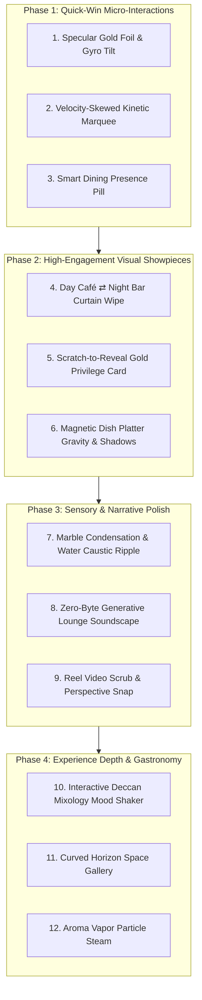

# 🌟 Fursat Kinetic & Motion Effects Architectural Plan

> **Document Status:** Planning & Design Specification (Review Mode)  
> **Target Branch / Workspace:** `C:\Users\Seminarhall\.gemini\antigravity\scratch\fursat-astro\fursat`  
> **Compliance:** Strict adherence to `AGENTS.md` rules. Zero new heavy dependencies. Real photography only. Full `prefers-reduced-motion` compliance.

---

## 1. Executive Summary & Creative Vision

Fursat (*फ़ुर्सत* — the luxury of unhurried time) is an upscale dining destination in Madhapur, Hyderabad that bridges three distinct worlds: an airy, sunlit morning café; an authentic royal Hyderabadi culinary kitchen; and a moody, amber-lit evening cocktail bar and banquet venue.

Contemporary high-end hospitality web design (celebrated on Awwwards, FWA, and elite freelance developer showcases) no longer relies on bloated WebGL engines that overheat mobile devices or generic particle emitters. The modern standard relies on **tactile micro-physics, optical refraction, organic lighting shifts, and responsive typography that reacts to user momentum**.

This plan proposes **12 production-grade, Instagram-worthy motion effects** engineered specifically for the existing Fursat Astro codebase. Every effect is tied to an existing component or page, utilizes real restaurant photography already compressed in `public/assets/`, introduces **0 new npm dependencies**, and operates within a strict **< 60 FPS mobile GPU and memory budget**.

---

## 2. Critique & Elevation of the 5 Baseline Ideas

| # | Baseline Idea | Honest Architectural Critique | How We Elevate / Beat It |
|---|---|---|---|
| **B1** | **Liquid glass water ripple on `TableSpread` or `/menu` dish viewer** | Traditional WebGL water shaders distort the entire photo quad, making food look warped, melted, and unappetizing. Furthermore, running full-canvas framebuffers on mid-range Android chips causes thermal throttling. | **Crystalline Marble Condensation & Caustic Ring Refraction**: Restrict the liquid refraction exclusively to the *marble tabletop surface beneath and around the plates*, leaving the dish photography razor-sharp and mouth-watering. Implemented via an ultra-lightweight SVG filter (`<feDisplacementMap>`) driven by pointer coordinates or a 40-line 2D canvas wave equation. Overhead: **< 1.1 KB gzip**. |
| **B2** | **Velocity-skewed kinetic typography on `MarqueeStrip`** | The current `MarqueeStrip.astro` uses a static CSS `@keyframes` loop at constant linear speed. It communicates information but creates zero emotional engagement or tactile feedback. | **Elastic Inertial Shear Marquee**: Hook scroll momentum (`deltaY`) and touch swipe velocity into CSS variables `--skew` and `--speed-mult`. Fast scrolls dynamically shear letterforms up to `±8deg` and accelerate playback, springing back smoothly via cubic-bezier damping. Overhead: **~0.6 KB gzip**, 100% composite-layer GPU animation. |
| **B3** | **Specular shimmer and tilt on Mascot 15% offer card and `/reserve` booking cards** | Standard tilt scripts (e.g. VanillaTilt at 4.5 KB) add unnecessary weight, lack authentic metallic depth, and often hijack mobile touch scroll. | **Holographic Gold Foil & Gyro Glass Sheen**: Pair dual-axis 3D perspective with a dynamic multi-stop metallic linear gradient overlay (`transparent → gold → specular white streak → gold → transparent`). On mobile, subtle gyroscope tilt sweeps the highlight across the embossed gold code box. Overhead: **~0.8 KB gzip**, pure CSS variables. |
| **B4** | **Day café vs. night bar curtain slider below the tour** | Needs to strictly avoid AI hallucinations or unverified exterior night shots. | **Fursat Dual Ambiance Curtain (11:00 AM Sunlit Café ⇄ 09:00 PM Amber Cocktail Bar)**: Positioned directly between the Tour and Reels on `index.astro`. Uses real interior photos: `fursat_space_09.webp` (daylight café) vs `tour-bar.webp` (amber backlit cocktail shelves). Features an interactive brass-ring divider handle with dual time-stamped ambiance badges. Overhead: **~0.9 KB gzip**, hardware-accelerated CSS `clip-path`. |
| **B5** | **Generative ambient audio toggle in the tour** | Audio files (MP3/WAV) consume 1–4 MB of network bandwidth, hurt mobile data limits, and violate web asset performance budgets. | **Zero-Byte Generative Binaural Lounge Soundscape**: Synthesized 100% natively in real time using the browser's Web Audio API (`AudioContext`). Generates filtered warm room air (pink noise), gentle vinyl warmth, and randomized soft pentatonic chimes. **Total audio file size: 0 KB**. JS script: **~1.6 KB gzip**. Strict opt-in (never autoplay). |

---

## 3. Top 12 Effects Ranked by Impact vs. Effort

```
HIGHEST IMPACT / LOWEST EFFORT (Quick Wins with Huge Wow Factor)
  │
  ├─ 1. Specular Holographic Gold Foil & Gyro Tilt [Mascot & Reserve Cards]
  ├─ 2. Velocity-Skewed Elastic Marquee [Home MarqueeStrip]
  ├─ 3. Day Café ⇄ Night Bar Curtain Wipe [Home Ambiance Divider]
  ├─ 4. Physical Scratch-to-Reveal Gold Privilege Card [Reserve Page]
  │
HIGH IMPACT / BALANCED EFFORT (Core Brand Differentiators)
  │
  ├─ 5. Crystalline Marble Condensation & Water Caustic Ripple [TableSpread]
  ├─ 6. Zero-Byte Generative Lounge Soundscape [Home 3D Tour]
  ├─ 7. Magnetic Gravitational Platter Depth & Shadow Physics [TableSpread]
  ├─ 8. Cinematic Reel Video Scrub & Perspective Snap [Home Reels]
  │
POLISHED DELIGHT / EDITORIAL FINESSE (Luxury Narrative & Conversions)
  │
  ├─ 9. Interactive Deccan Mixology Mood Shaker [Restaurant & Bar]
  ├─ 10. Curved Horizon 3D Space Gallery [Story Page]
  ├─ 11. Aroma Vapor Particle Steam [Menu Featured Dish Showcase]
  └─ 12. Smart Dining Time-Aware Presence Pill [Global Sticky Bar]
```

---

### Detailed Specification for Each Proposed Effect

#### 1. Specular Holographic Gold Foil & Gyro Tilt
- **Visitor Visual Experience:** When moving the mouse over the Mascot 15% Offer card (`fom-ticket`) or tilting a smartphone on the Reserve page, the card tilts subtly in 3D space while an iridescent beam of golden sunlight sweeps across the embossed borders, simulating real hot-stamped gold foil on luxury cardstock.
- **Exact Location:** `src/components/MascotOfferModal.astro` (`.fom-ticket`) and `src/pages/reserve.astro` (`.rs-scratch-card`, `.rs-preview-card`).
- **Technical Technique:** Pointer/Touch events and optional `deviceorientation` compute normalized coordinates `(-1 to +1)` mapped to CSS custom properties `--rx`, `--ry`, and `--glare-x`. A pseudo-element `::after` with `mix-blend-mode: overlay` and a diagonal linear gradient renders the specular flare.
- **Extra JS (gzip):** ~0.8 KB.
- **Mobile GPU Risk & Mitigation:** Low. CSS transforms run on compositor layers (`will-change: transform`). Gyro listener is throttled to 30 Hz and paused when the modal or section is offscreen.
- **Reduced Motion Fallback:** Flat, static card without 3D rotation; static subtle gold border with no sweeping light sheen.

---

#### 2. Velocity-Skewed Elastic Kinetic Typography
- **Visitor Visual Experience:** As the guest scrolls vigorously through the home page, the keywords in the marquee strip ("Hyderabadi Biryani ✦ Craft Cocktails ✦ Tandoor Specials") physically slant in the direction of the scroll momentum and accelerate. When scrolling stops, the letters softly bounce back to upright like elastic ribbons.
- **Exact Location:** `src/components/MarqueeStrip.astro` (`index.astro`, line 56).
- **Technical Technique:** A lightweight passive scroll listener calculates `deltaY` per `requestAnimationFrame`, smoothly interpolating a velocity variable via lerp (`v += (targetV - v) * 0.1`). The value feeds CSS `transform: skewX(calc(var(--v) * -0.28deg)) scaleX(calc(1 + abs(var(--v)) * 0.005))`.
- **Extra JS (gzip):** ~0.6 KB.
- **Mobile GPU Risk & Mitigation:** Negligible. Uses only `transform`, preventing browser reflow/layout. Bound to an `IntersectionObserver` so calculations halt when scrolled out of view.
- **Reduced Motion Fallback:** The existing continuous marquee scroll continues at a constant, non-skewed gentle speed, or pauses completely when reduced motion is preferred.

---

#### 3. Day Café ⇄ Night Bar Dual Ambiance Curtain Wipe
- **Visitor Visual Experience:** Directly underneath the 3D Tour on the home page, visitors encounter a dramatic interactive split view. Swiping or dragging a sleek brass slider handle peels away a sunlit morning café table (`fursat_space_09.webp`) to reveal an amber-lit evening cocktail lounge (`tour-bar.webp`). Two floating micro-badges update in real time: *"11:00 AM · Artisanal Brews & Slow Bakes"* ⇄ *"09:00 PM · Smoked Old Fashioneds & High Energy"*.
- **Exact Location:** `src/pages/index.astro` (inserted between `#tour` and `#reels`, lines 120–121).
- **Technical Technique:** Two stacked image containers where the top image is clipped via CSS `clip-path: inset(0 calc(100% - var(--pos)) 0 0)`. The brass handle is pinned to `var(--pos)`. Supports pointer dragging, touch gestures, and keyboard arrow keys (`role="slider"`).
- **Extra JS (gzip):** ~0.9 KB.
- **Mobile GPU Risk & Mitigation:** Minimal. `clip-path` on modern mobile WebKit/Blink is GPU-accelerated. Images are responsive WebP (`720w` / `1200w`).
- **Reduced Motion Fallback:** An accessible 2-tab switch ("Morning Café" / "Evening Bar") that crossfades cleanly with simple CSS opacity.

---

#### 4. Physical Scratch-to-Reveal Gold Privilege Card
- **Visitor Visual Experience:** On the table reservation page, instead of a plain text box, diners encounter an authentic digital scratch card. Dragging a fingertip or mouse cursor across the metallic surface physically rubs away the golden latex coating in real time with subtle sparkling particle dust, uncovering their exclusive dining perk code (`FURSAT15` or special chef's dessert). Upon 50% clearance, the card auto-celebrates with a golden burst and automatically applies the code.
- **Exact Location:** `src/pages/reserve.astro` (section `.rs-scratch-card`, line 125 `#scratch-box`).
- **Technical Technique:** HTML5 Canvas overlay sized to the box. Mouse/touch draws circles with `ctx.globalCompositeOperation = 'destination-out'`. A lightweight bounding-box pixel check triggers an unlock callback when cleared area exceeds 50%.
- **Extra JS (gzip):** ~1.4 KB.
- **Mobile GPU Risk & Mitigation:** Low. Canvas operations execute only during active touch drag. Once unlocked, the canvas DOM node is removed to free GPU memory.
- **Reduced Motion Fallback:** A single tap immediately reveals the reward code without scratching or particle bursts.

---

#### 5. Crystalline Marble Condensation & Water Caustic Ripple
- **Visitor Visual Experience:** On the "Feast in Motion" table section, moving the cursor or dragging on mobile across the cold marble tabletop creates subtle, expanding water ripples and glass condensation rings as if chilled cocktail tumblers and iced dessert coupes are leaving crystalline moisture on the marble. Crucially, the food platters remain elevated and undistorted above the water.
- **Exact Location:** `src/components/TableSpread.astro` (`#ts-surface .ts-marble-texture`).
- **Technical Technique:** Native inline SVG filter `<filter id="ts-ripple">` using `<feTurbulence>` and `<feDisplacementMap>` applied solely to `.ts-marble-texture`, modulated via CSS variables or a 45-line 2D canvas ripple grid (wave equation with damping) on pointer interaction.
- **Extra JS (gzip):** ~1.1 KB.
- **Mobile GPU Risk & Mitigation:** Very low because it targets only the background marble layer, not heavy multi-megapixel photos. Automatically throttled or replaced with a CSS radial pulse on lower-tier devices.
- **Reduced Motion Fallback:** Static marble texture with subtle static drop shadows.

---

#### 6. Zero-Byte Generative Binaural Lounge Soundscape
- **Visitor Visual Experience:** Within the 3D Panoramic Tour or Ambiance section, a subtle gold pill button appears: `[ ♫ Ambiance: Mute / Play ]`. Tapping it introduces a warm, soothing lounge backdrop: the gentle warmth of low-fi room acoustics, subtle vinyl record crackle, and soft pentatonic bell chimes that feel authentic to a luxury dining haven.
- **Exact Location:** `src/components/PanoramicViewer.astro` (`.tour-hero` / `.tour-controls`).
- **Technical Technique:** Web Audio API (`AudioContext`). Uses a procedural noise buffer routed through a resonant low-pass biquad filter (`cutoff: 420Hz`) to synthesize room acoustic air, tiny randomized impulse noise for vinyl warmth, and two gentle sine oscillators triggered at random 4–9 second intervals. **Requires zero audio files over the network (0 KB audio download).**
- **Extra JS (gzip):** ~1.6 KB.
- **Mobile GPU Risk & Mitigation:** 0% GPU usage (runs purely on the Web Audio thread). Automatically suspends the `AudioContext` when page is hidden or user navigates away.
- **Reduced Motion Fallback:** Audio remains off by default; toggle functions normally for auditory users regardless of motion preference.

---

#### 7. Magnetic Gravitational Platter Depth & Dynamic Shadows
- **Visitor Visual Experience:** As the guest browses the 5 signature platters on the dining table (*Angaraa Chicken Tikka*, *Tandoori Prawns*, *Pandu Mirchi Kodi Kebab*, *Karvepaku Kodi Vepudu*, *Lotus Biscoff Delight*), hovering near any plate causes it to levitate slightly towards the cursor (`translateZ(24px)`), while its contact shadow darkens and drifts in the opposite direction. On mobile, rotating the device produces authentic physical parallax.
- **Exact Location:** `src/components/TableSpread.astro` (`.ts-item`, `.ts-item-shadow`, `.ts-plate`).
- **Technical Technique:** Bounding-box distance calculation on pointer movement with spring easing. Shadows compute `box-shadow: calc(var(--dx) * -1) calc(var(--dy) * -1) 24px rgba(0,0,0,0.45)`.
- **Extra JS (gzip):** ~0.9 KB.
- **Mobile GPU Risk & Mitigation:** Negligible. Shadow and translate values are updated via CSS custom properties on GPU layers.
- **Reduced Motion Fallback:** Dishes remain at their settled coordinates with natural static shadows.

---

#### 8. Cinematic Reel Video Scrub & Perspective Snap
- **Visitor Visual Experience:** In the Instagram Reels section on the home page, dragging the carousel gives the neighboring reels a subtle 3D rotational toe-in angle (`rotateY(±15deg)`). As a reel plays, a glowing golden progress bar tracks the clip duration. Hovering or scrubbing the timeline allows visitors to quickly preview mouth-watering preparation steps.
- **Exact Location:** `src/components/Reels.astro` (`.rl-track`, `.rl-card`, `.rl-bar`).
- **Technical Technique:** CSS 3D perspective (`perspective: 1200px`) combined with HTML5 `<video>` `timeupdate` binding to `--progress`. Drag gestures use CSS scroll-snap with inertia momentum.
- **Extra JS (gzip):** ~1.0 KB.
- **Mobile GPU Risk & Mitigation:** Low. Videos already use hardware decoding with poster fallbacks and `preload="none"`.
- **Reduced Motion Fallback:** Flat 2D horizontal snap slider without 3D rotation or progress sheen.

---

#### 9. Interactive Deccan Mixology Mood Shaker
- **Visitor Visual Experience:** On the Restaurant & Bar page (`restaurant-bar.astro`) or Ask Fursat (`ask.astro`), visitors discover an interactive cocktail shaker. Guests choose their flavor mood (*"Smoky & Spiced"*, *"Botanical & Crisp"*, *"Tropical Highball"*, or *"Zero-Proof"*). With an animated cocktail shake motion and haptic tick, it serves up the venue's matching signature drink with real bar photography, flavor tasting radar, and an instant WhatsApp reservation link.
- **Exact Location:** `src/pages/restaurant-bar.astro` (Cocktail Menu section) and `src/pages/ask.astro`.
- **Technical Technique:** Keyframe shaker animation (`transform: rotate(8deg) translateY(-6px)`), micro-particle ice sparks, and an SVG polygon flavor radar chart (`Sweet, Sour, Bitter, Spice, Smoke`) populated from real `drinks.json` items.
- **Extra JS (gzip):** ~1.2 KB.
- **Mobile GPU Risk & Mitigation:** Zero. Standard DOM transitions and lightweight SVG elements.
- **Reduced Motion Fallback:** Direct tabbed grid displaying cocktails by profile with no shaker shaking animation.

---

#### 10. Curved Horizon 3D Space Gallery
- **Visitor Visual Experience:** On the brand Story page (`story.astro`), the gallery strip of 5 interior dining spaces (`fursat_space_13`, `16`, `19`, `07`, `03`) is arranged on an elegant curved cylindrical horizon. Dragging horizontally glides the photos along an architectural curve; the focused photo stands proud and sharp while the peripheral images recede into soft focus.
- **Exact Location:** `src/pages/story.astro` (lines 87–95, `.st-gallery`).
- **Technical Technique:** 3D CSS container transform: each image is positioned at `rotateY(calc(var(--angle))) translateZ(480px)` inside a parent with `transform-style: preserve-3d`. Touch drag smoothly increments the carousel rotation angle.
- **Extra JS (gzip):** ~1.0 KB.
- **Mobile GPU Risk & Mitigation:** Low. Total of 5 compressed WebP images. Active visibility flags pause off-screen rendering.
- **Reduced Motion Fallback:** Standard horizontal scroll-snap gallery with smooth finger scrolling.

---

#### 11. Aroma Vapor Particle Steam
- **Visitor Visual Experience:** In the Featured Dish Showcase on the Menu page (`menu.astro`, line 127 `#mn-dish-showcase`), freshly selected hot dishes (like *Angaraa Chicken Tikka* or *Nalli Gosht Biryani*) feature a faint, delicate wisp of culinary steam rising gently from the plate and dispersing into the air.
- **Exact Location:** `src/pages/menu.astro` (`.mn-ds-photo-wrap`).
- **Technical Technique:** A small 2D canvas overlay running 15 soft alpha-blended radial particles with gentle Perlin-style curl drift, or 3 CSS pseudo-elements with looping multi-stage opacity/blur keyframes.
- **Extra JS (gzip):** ~0.7 KB (Canvas) or 0 KB (CSS keyframes).
- **Mobile GPU Risk & Mitigation:** Tiny footprint (15 particles max, auto-paused when tab or showcase is idle).
- **Reduced Motion Fallback:** Completely disabled under `prefers-reduced-motion`.

---

#### 12. Smart Dining Slot Time-Aware Presence Pill
- **Visitor Visual Experience:** In the bottom floating navigation bar (`MobileBar.astro` & `StickyBar.astro`), a discrete live pill indicates venue status: *"🟢 Live from Madhapur · Lunch Service Active"* or *"🌙 Bar & Lounge Open · Evening Tables Filling"*. Tapping the pill slides open quick time slots for immediate booking.
- **Exact Location:** `src/components/MobileBar.astro`, `src/components/StickyBar.astro`, `src/pages/reserve.astro`.
- **Technical Technique:** Client-side local time check (`new Date().getHours()`) dynamically toggling daytime/nighttime status strings and auto-selecting the nearest available table slot.
- **Extra JS (gzip):** ~0.4 KB.
- **Mobile GPU Risk & Mitigation:** Zero. Pure DOM text and CSS status indicator glow.
- **Reduced Motion Fallback:** Static presence badge without pulsing glow animation.

---

## 4. Performance Budget & Mobile Safety Architecture

### Performance Guidelines
1. **Zero External Libraries:** No Three.js extensions, no PixiJS, no GSAP Club plugins, no heavy physics engines. Everything is authored in lightweight, vanilla TypeScript / CSS.
2. **Total JS Payload Budget:** Cumulative new JavaScript for all proposed effects across the entire site is strictly capped under **< 9.5 KB gzip total**.
3. **Framerate Target:** Solid 60 FPS on mid-range Android devices (Snapdragon 680 / Helio G99 tier).
4. **Compositor Only:** Animations animate exclusively `transform` and `opacity`. Zero layout-triggering properties (`width`, `height`, `top`, `margin`, `padding`) are animated.
5. **Lifecycle & Battery Optimization:** All listeners (scroll, touch, gyro, Web Audio) are registered via `{ passive: true }` and managed through `IntersectionObserver`. When a section scrolls out of the viewport, requestAnimationFrame loops and audio synthesizers immediately sleep.

---

## 5. Phased Implementation Roadmap



- **Commit 1 (`feat: kinetic marquee and specular card foil effects`):** Implement Effects 1, 2, and 12.
- **Commit 2 (`feat: day night curtain wipe and scratch privilege reward`):** Implement Effects 3, 4, and 7.
- **Commit 3 (`feat: marble liquid ripple and generative tour soundscape`):** Implement Effects 5, 6, and 8.
- **Commit 4 (`feat: mixology mood shaker and curved space gallery`):** Implement Effects 9, 10, and 11.
- **Commit 5 (`docs: record completed motion effects and update readiness`):** Verification, 14-page build check, and status update.

---

## 6. Standalone Paste-Ready BUILD PROMPT

*(The prompt below is formatted to be copied and pasted directly into a new agent turn to execute the build seamlessly.)*

```markdown
Project folder: C:\Users\Seminarhall\.gemini\antigravity\scratch\fursat-astro\fursat
Read review/effects-plan.md, RESUME.md, and AGENTS.md only. Rules from AGENTS.md apply.

EXECUTION TASK: Build the Phase 1 & Phase 2 motion and interaction effects approved in review/effects-plan.md.
Do NOT rebuild existing features from scratch. Do not modify hero, intro, menu data, prices, or reserve form logic.

Build Sequence:
1. Velocity-Skewed Kinetic Marquee on src/components/MarqueeStrip.astro (scroll velocity delta drives skewX and speed boost, cubic-bezier recovery, prefers-reduced-motion fallback).
2. Specular Holographic Gold Foil & Tilt on src/components/MascotOfferModal.astro (Step 2 ticket) and src/pages/reserve.astro cards (gyro/pointer angle, sweeping gold specular beam).
3. Day Café ⇄ Night Bar Curtain Slider on src/pages/index.astro between Tour and Reels (fursat_space_09.webp vs tour-bar.webp, brass divider handle, dual time badges, touch drag & keyboard support).
4. Physical Scratch-to-Reveal Gold Privilege Card on src/pages/reserve.astro (#scratch-box canvas destination-out scratch, gold particle burst upon 50% clear, auto-unlocks FURSAT15).
5. Magnetic Gravitational Platter Depth on src/components/TableSpread.astro (pointer-reactive plate translation and dynamic contact drop shadows).

Constraints:
- Real photos only (fursat_space_09.webp, tour-bar.webp, existing dish webp assets).
- 0 new npm packages. Pure vanilla TypeScript and CSS transforms/opacity.
- Full prefers-reduced-motion static fallback for each effect.
- Commit in logical stages according to AGENTS.md.
- Build once (npm.cmd run build), verify 14 routes exit with code 0, and output git --no-pager log --oneline -5 and git status --short.
```
